# 美术资源管理器使用教程

内容版本：V0.7.12

按实际工作流程查找功能：浏览素材、检查模型与贴图、追踪引用、组合导出，以及安装和更新。每个主题都配有操作图解。

> 安装包、管理器内入口与在线教程使用同一份内容。图中资源为教学示例，按钮位置以你安装的版本为准。

## 安装与打开

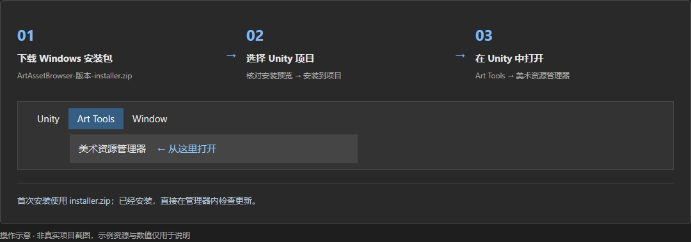

*操作示意，非真实项目截图。*

1. 首次使用：下载仓库首页的 Windows 安装包，完整解压，运行 ArtAssetBrowserInstaller.exe。不要只取出 EXE，其他随附文件也请保留。
2. 选择需要使用工具的 Unity 项目根目录，也就是包含 Assets、Packages 和 ProjectSettings 的那一层。
3. 核对安装预览，点击安装到项目。默认安装在 Assets/Editor/com.artasset.browser；已有 Editor 目录会复用，没有时自动建立。
4. 回到 Unity 等待导入完成，从 美术资源管理器 / 打开管理器打开。安装包内的使用教程.html、管理器中的使用教程和 GitHub 在线教程内容一致。

> 日常使用不必反复打开安装器，更新与卸载均可从管理器操作。

> 适用环境：Windows x64；Unity 2022.3.62f2c1。其他 Unity 版本请先在测试项目中确认兼容性。

## 浏览、筛选与选择资源

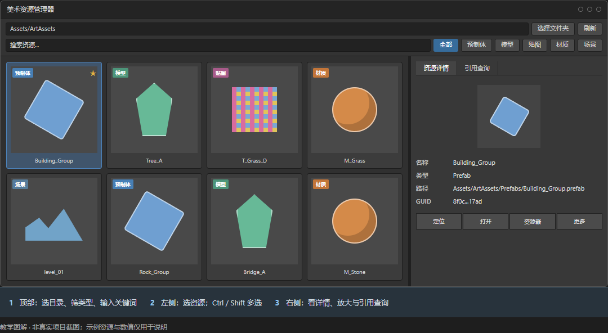

*操作示意，非真实项目截图。*

1. 选择 Assets 下的浏览目录，点击刷新重新读取资源列表。刷新不会重建引用索引。
2. 左键点击预制体、模型、贴图、材质或场景进行单选；右键或 Ctrl+左键追加或取消类型，至少保留一种。全部恢复所有类型。
3. 搜索框可输入名称或路径；空格分开的多个关键词需要同时匹配。A–Z 菜单可按字母或数字开头继续筛选。
4. 单击卡片查看右侧详情，双击卡片在 Unity Project 中定位资源；打开资源请点详情中的打开按钮。资源详情预览图的双击用于放大预览。
5. Ctrl+左键追加或取消导出选择，Shift+左键选择连续范围。右键已选资源，打开组合导出菜单。
6. 底部尺寸滑块调整卡片大小，缩到较小时切为紧凑列表。拖动中间分隔条调整列表与详情的宽度；向上箭头返回列表顶部。

> 类型、目录、搜索和收藏条件共同生效。看不到资源时，先检查当前筛选条件。

## 目录分类与中文名称

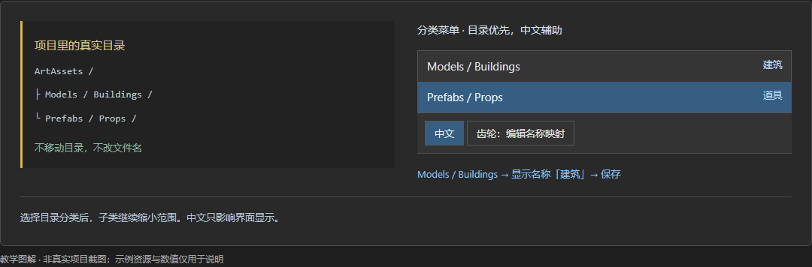

*操作示意，非真实项目截图。*

1. 分类和子类来自浏览目录下的文件夹层级，括号内数字帮助判断各类资源数量。
2. 分类菜单以目录路径为主要查找依据，中文名辅助识别；选择子类可以继续缩小范围。
3. 点击中文开关切换显示方式，齿轮打开分类名称映射。修改对应的显示名称后保存。

> 中文映射只改变本机界面显示，不改资源文件夹、资源名或引用关系。

## 最近搜索与收藏

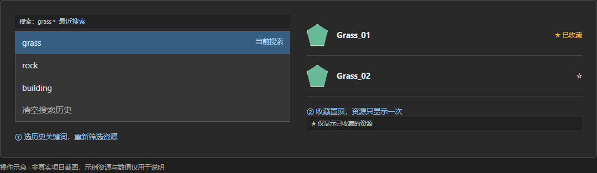

*操作示意，非真实项目截图。*

1. 点击搜索框展开最近搜索，输入时匹配历史关键词。按 Enter 确认或点击历史条目后才记录，最多保留最近 10 条；仅离开输入框或关闭窗口不会记录草稿。
2. 点击历史条目立即筛选并移到最前；上下键选择、Enter 使用、Esc 收起。每条右侧 × 可删除单条，底部清空需要确认；清空历史保留当前搜索文字，均不会删除资源。
3. 点击资源星号收藏或取消收藏。收藏资源在当前结果内置顶，仍只显示一次，也不移动文件。
4. 顶部星号开关只显示已收藏的资源；再次关闭可回到全部匹配结果。

> 收藏不会绕过目录、类型、首字母或搜索条件。收藏与搜索历史保存在本机。

## 模型放大、结构、线框与法线

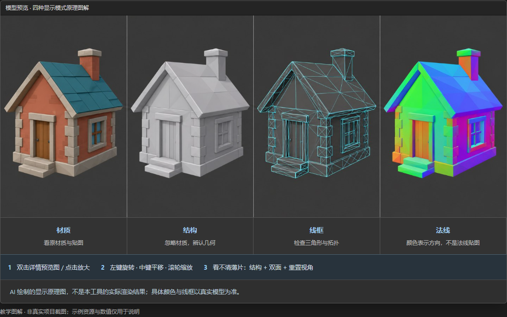

*操作示意，非真实项目截图。*

1. 选中模型或预制体后，双击资源详情中的预览图，或点击放大图标，打开独立预览。
2. 左键拖动旋转；中键拖动或按住 Shift 拖动平移；滚轮缩放；重置视角按钮恢复初始构图。
3. 材质模式看原材质效果；结构模式忽略材质干扰查看几何；线框模式辨认三角形；法线模式用颜色表示世界空间顶点法线方向。
4. 薄草片、边界面或单面模型看不清时，先切结构，再尝试双面和重置视角。双面仅影响临时预览。
5. 继续选择其他资源时，已经打开的预览跟随选择，不必反复开窗。

> 图中的四种效果是原理示意，不是软件实拍；法线模式不是查看法线贴图。

> 卡片上的结构标记表示临时结构预览，不代表原材质效果。

> 编译、导入、烘焙或运行游戏时预览可能暂停；部分设备不支持线框。预览不会自动修改原资源或保存场景。

## 贴图放大与资源详情

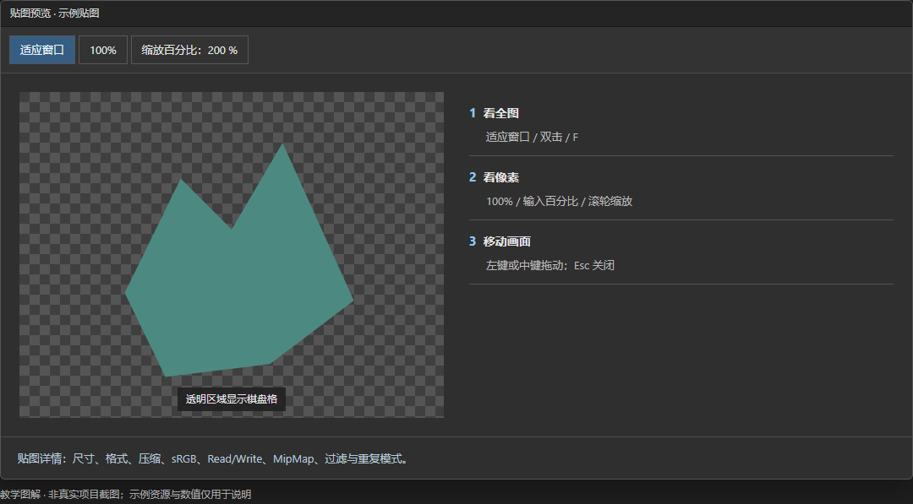

*操作示意，非真实项目截图。*

1. 选择贴图，在资源详情查看尺寸、导入格式与类型、最大尺寸、压缩、sRGB、Read/Write、MipMap、过滤及重复模式等信息。
2. 双击详情预览图或点击放大图标，打开贴图预览。滚轮围绕指针缩放，左键或中键拖动画面。
3. 适应窗口、F 键或双击画面恢复全图；100% 表示一个贴图像素对应一个屏幕像素，也可输入缩放百分比。Esc 关闭贴图窗口。
4. 模型、预制体和材质的详情随资源类型变化。路径与 GUID 可展开查看；定位跳到 Unity Project，打开交给 Unity，资源器打开文件所在位置，更多菜单用于复制等操作。

> 详情用于查看信息，不会替你更改导入设置。透明贴图的棋盘格是预览背景，不是贴图内容。

## 模型统计与 LOD 检查

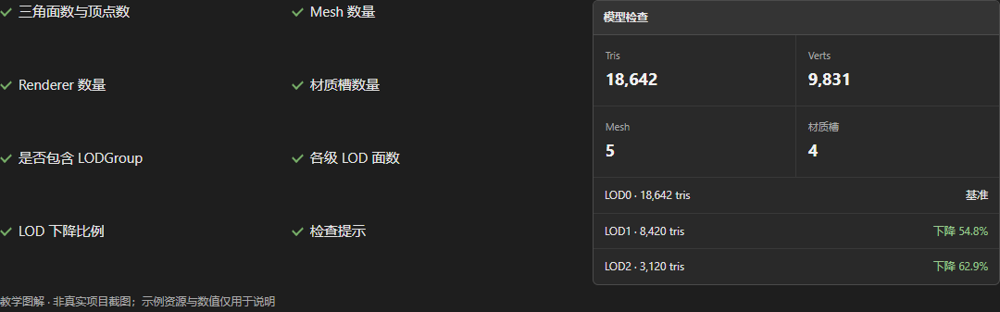

*操作示意，非真实项目截图。*

1. 选择模型或预制体，在资源详情查看三角面、顶点、Mesh、Renderer 和材质槽数量。
2. 展开 LOD 检查查看是否存在 LODGroup、各级面数和下降比例。
3. 把统计与实际资产用途一起判断；未发现 LODGroup 不等于资源不可用，面数也不是唯一质量标准。

> 统计与 LOD 检查只读，不会自动减面或生成 LOD。图中数值仅为说明示例。

## 引用来源、资源依赖与场景内查

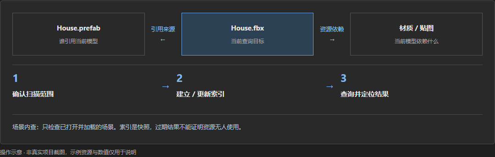

*操作示意，非真实项目截图。*

1. 在引用查询页选定查询目标。使用当前可采用 Unity 当前选择；从 Project 右键 美术资源管理器 / 查看引用，也可直接带入资源。
2. 确认扫描目录并建立索引。引用来源查谁引用它，资源依赖查它需要谁；递归依赖可继续查下一层依赖。
3. 场景内查仅检查已打开并加载的场景；结果可选中场景对象、查看层级或复制层级路径。
4. 查询结果支持搜索和简洁 / 详细显示；可定位、打开、查看文件位置或复制路径。导出按钮输出当前查询结果的文本报告。
5. 高级设置可调整扫描目录、含 Packages、递归依赖、检查打开场景和链路深度。范围变化后重新建索引；深度扫描仅在索引漏查等情况使用。清空只清除当前结果，不删除索引。

> 索引是本机快照，不是实时结果。资源变更或扫描范围不足时，不能据此断言资源未被使用。

> 含 Packages 需重新建索引才生效；扩大范围或使用深度扫描会增加耗时。

## 只读资源检查与报告

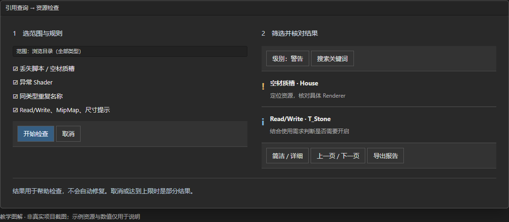

*操作示意，非真实项目截图。*

1. 进入引用查询 / 资源检查，范围选择当前查询资源或浏览目录（全部类型）。
2. 展开检查规则，按需要勾选丢失脚本 / 空材质槽、异常 Shader、同类型重复名称、Read/Write、MipMap 和最大导入尺寸提示；尺寸阈值可调整。
3. 点击开始检查。检查中可取消；结果可按错误、警告、提示与关键词筛选，并分页查看。
4. 定位结果核对具体资源，必要时切详细模式查看原因与路径，也可导出文本报告。

> 这是只读检查，不会自动修复或删除资源。已取消、达到上限或范围不足时，只能视为部分结果。

> 同名、MipMap 或 Read/Write 提示需要结合用途判断，不一定代表错误。

## Shader 使用查询

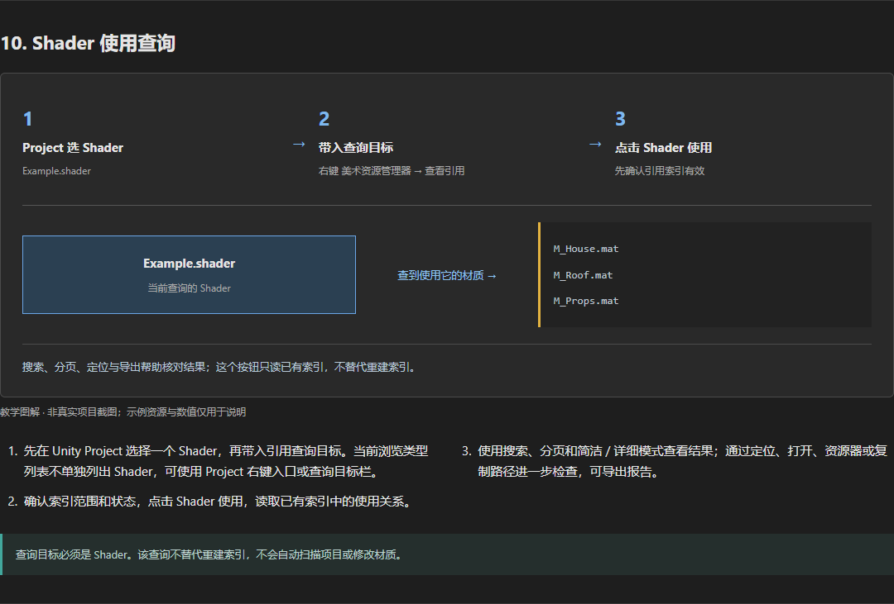

*操作示意，非真实项目截图。*

1. 先在 Unity Project 选择一个 Shader，再带入引用查询目标。当前浏览类型列表不单独列出 Shader，可使用 Project 右键入口或查询目标栏。
2. 确认索引范围和状态，点击 Shader 使用，读取已有索引中的使用关系。
3. 使用搜索、分页和简洁 / 详细模式查看结果；通过定位、打开、资源器或复制路径进一步检查，可导出报告。

> 查询目标必须是 Shader。该查询不替代重建索引，不会自动扫描项目或修改材质。

## 拖入 Unity 场景

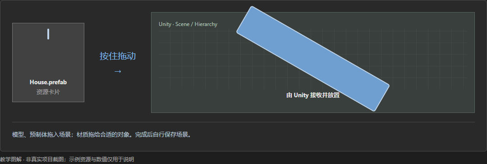

*操作示意，非真实项目截图。*

1. 按住模型或预制体卡片拖到 Scene 或 Hierarchy，由 Unity 原生拖放放置对象。
2. 材质球拖到能接收材质的对象或位置；是否接受由 Unity 当前目标决定。
3. 没有效果时，检查拖放目标和资源类型，以及 Unity 是否正在编译、导入或运行。

> 拖放会产生正常的场景编辑，但工具不会替你保存场景。请按自己的工作流程保存。

## 多选组合导出模型与贴图

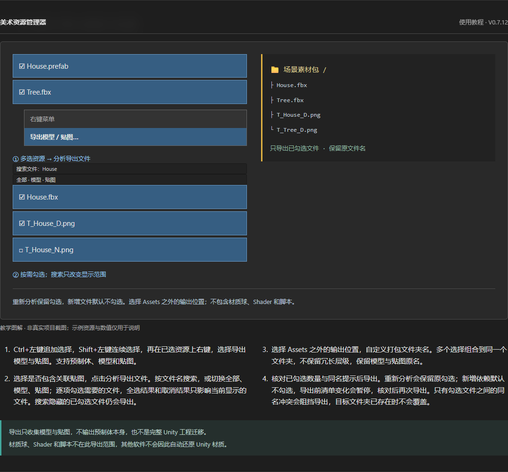

*操作示意，非真实项目截图。*

1. Ctrl+左键追加选择，Shift+左键连续选择，再在已选资源上右键，选择导出模型与贴图。支持预制体、模型和贴图。
2. 选择是否包含关联贴图，点击分析导出文件。按文件名搜索，或切换全部、模型、贴图；逐项勾选需要的文件，全选结果和取消结果只影响当前显示的文件。搜索隐藏的已勾选文件仍会导出。
3. 选择 Assets 之外的输出位置，自定义打包文件夹名。多个选择组合到同一个文件夹，不保留冗长层级，保留模型与贴图原名。
4. 核对已勾选数量与同名提示后导出。重新分析会保留原勾选；新增依赖默认不勾选，导出前清单变化会暂停，核对后再次导出。只有勾选文件之间的同名冲突会阻挡导出，目标文件夹已存在时不会覆盖。

> 导出只收集模型与贴图，不输出预制体本身，也不是完整 Unity 工程迁移。

> 材质球、Shader 和脚本不在此导出范围，其他软件不会因此自动还原 Unity 材质。

## 更新记录、自动检查与卸载

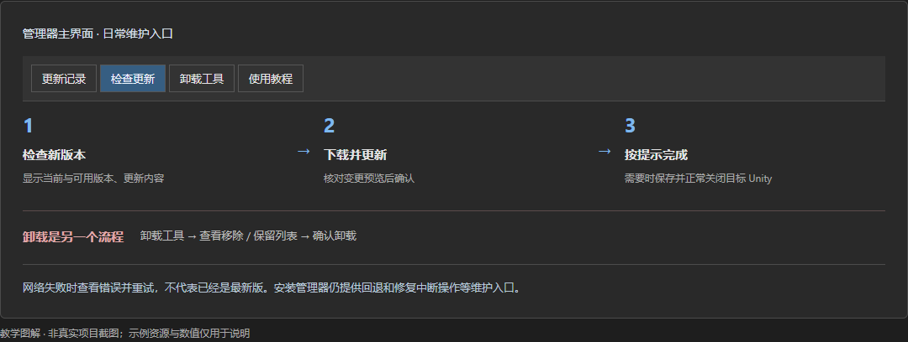

*操作示意，非真实项目截图。*

1. 更新记录显示各版改动，展开历史版本查看；当前工具版本显示在窗口标题和维护区域。
2. 管理器会按当前更新机制检查版本，也可点击检查更新主动获取信息。发现新版本后先阅读说明，再点击下载并更新，核对预览并确认。
3. 若提示等待 Unity 关闭，先保存工作并正常关闭目标项目，更新完成后重新打开；无需重复下载完整安装器或手动覆盖。
4. 卸载工具会先显示移除与保留列表，核对后再确认。收藏、索引、缓存等是否保留，以本次预览为准。
5. 更新失败时保留错误提示并重新检查，不要反复覆盖文件；需要回退或修复中断操作时，可从安装管理器对应入口查看预览后操作。

> 检查更新只获取公开版本信息，不上传项目资源。断网或网络失败不代表已经是最新版。

## Git / UGit 与 SVN 独立设置

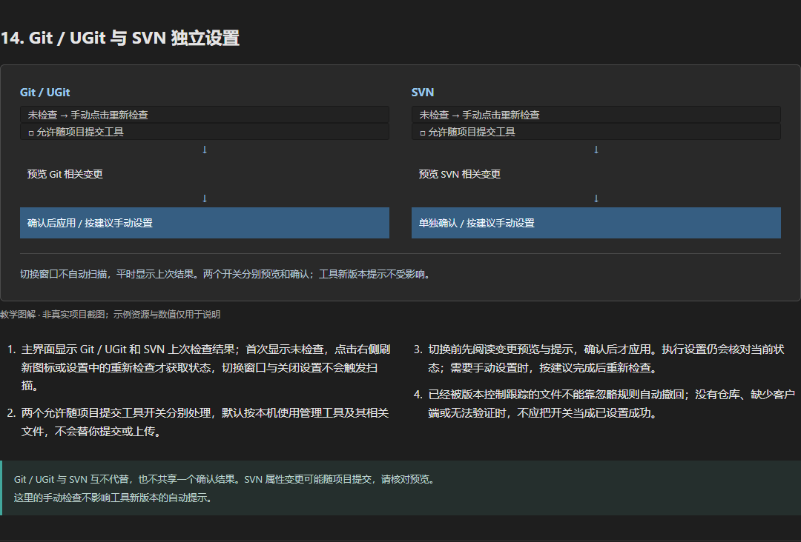

*操作示意，非真实项目截图。*

1. 主界面显示 Git / UGit 和 SVN 上次检查结果；首次显示未检查，点击右侧刷新图标或设置中的重新检查才获取状态，切换窗口与关闭设置不会触发扫描。
2. 两个允许随项目提交工具开关分别处理，默认按本机使用管理工具及其相关文件，不会替你提交或上传。
3. 切换前先阅读变更预览与提示，确认后才应用。执行设置仍会核对当前状态；需要手动设置时，按建议完成后重新检查。
4. 已经被版本控制跟踪的文件不能靠忽略规则自动撤回；没有仓库、缺少客户端或无法验证时，不应把开关当成已设置成功。

> Git / UGit 与 SVN 互不代替，也不共享一个确认结果。SVN 属性变更可能随项目提交，请核对预览。

> 这里的手动检查不影响工具新版本的自动提示。

## 缩略图模式、缓存与本机数据

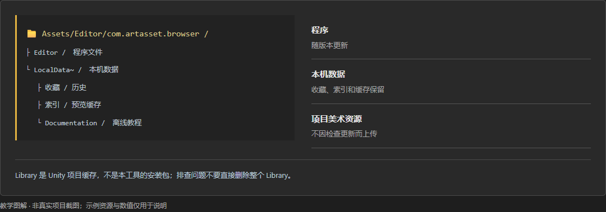

*操作示意，非真实项目截图。*

1. 预览菜单可选轻量缩略图或安全图标；资源很多、缩略图异常或想减少预览开销时，先切安全图标。
2. 清除预览缓存仅清除本机缩略图，不影响资源、收藏和引用索引；随后按需要重新生成。刷新资源列表也不等于清除缓存。
3. 收藏、历史、索引、缓存与本地教程集中在安装目录的 LocalData~。使用教程按钮会打开离线 HTML，更新后使用随新版携带的内容。
4. 反馈问题请提供工具版本、Unity 版本、操作步骤和错误信息，不上传凭据或未经授权的项目资源。

> Unity 项目的 Library 不是工具安装目录，不要为清理工具缓存而删除整个 Library。

> 缓存用于减少重复扫描和预览生成，不能替代美术资源备份。

